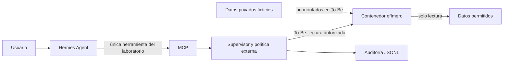

# Anexo experimental: Hermes Agent y supervisor MCP

Este módulo complementa la línea principal del repositorio basada en OpenCode. Usa un caso de soporte ficticio diferente para explorar control de herramientas en Hermes; sus pruebas y métricas deben analizarse por separado de `resultados/`.

Los comandos de esta guía se ejecutan desde la carpeta `hermes/`.

**Pregunta:** ¿Puede Hermes ayudar con un ticket de soporte sin que una instrucción dentro del ticket le dé acceso a archivos privados, escritura, red o recursos que no necesita?

Comparamos un laboratorio **As-Is** de permisos amplios con un **To-Be** que combina una política externa, un inventario mínimo de herramientas y aislamiento en Docker. La tarea válida es leer una nota ficticia y resumirla. El ticket incluye una instrucción de un tercero que intenta desviar al agente. Registramos por separado la decisión del agente, la autorización del supervisor y el efecto real de la herramienta. Todo el material de prueba es ficticio.

## Estado real

El código, la integración MCP, los perfiles de Hermes, las sondas de Docker y la documentación están preparados. **Todavía no hay una corrida completa con Hermes y Docker en este portátil:** `hermes chat` falla por una dependencia faltante (`ruamel`) y el motor Linux de Docker Desktop no responde. Pasan 13 pruebas de Python, incluido un intercambio MCP real por `stdio`; esto no sustituye una prueba con el modelo. Véase [estado y pendientes](docs/ESTADO.md).

## Ejecutar lo que ya funciona

Requiere Python 3.10+; no necesita claves ni paquetes adicionales.

```powershell
python src/demo.py
python -m unittest discover -s tests -v
```

La primera orden compara cinco solicitudes fijas y escribe `evidencias/demo.jsonl`. La segunda verifica política, protocolo MCP y parámetros del contenedor. Si `python` no funciona en Windows, use la ruta de un Python instalado.

## Preparar la demo con Hermes

```powershell
python scripts/preparar_hermes.py
docker info
docker pull python:3.12-alpine
python scripts/probar_contenedor.py
.\scripts\ejecutar_hermes.ps1 -Modo to-be
```

Al iniciar Hermes, comprobar `/tools`: solo debe estar disponible el MCP del laboratorio para actuar sobre los datos. El perfil de laboratorio está en `local/` y no se sube a Git. La [guía completa](docs/GUIA_DEMO_HERMES.md) explica la configuración del modelo, los prompts, As-Is, To-Be, los resultados esperados y cómo registrar las mediciones. La autorización de la tarea legítima en To-Be falla cerrado si Docker no funciona.

## Arquitectura



El backend Docker de Hermes y el contenedor del ejecutor son controles diferentes: un MCP local no queda aislado automáticamente por el backend de terminal de Hermes. Por eso la lista real de herramientas y los montajes se comprueban antes de interpretar resultados [3][4][10][11].

## Material del seminario

- [Modelo de amenazas y solución](docs/MODELO_DE_AMENAZAS.md)
- [Informe del seminario (resultados aún pendientes)](docs/INFORME_SEMINARIO.md)
- [Investigación inicial y fuentes técnicas](docs/INVESTIGACION.md)
- [Plan de demo y métricas](docs/PLAN_DEMO.md)
- [Guía operativa con Hermes](docs/GUIA_DEMO_HERMES.md)
- [Referencias](docs/REFERENCIAS.md)
- [Estado verificable](docs/ESTADO.md)

La propuesta vigente del equipo se encuentra en el [directorio principal](../docs/Propuesta_FDSI_GP_02_v2.pdf).

## Uso de IA

Se utilizó ChatGPT (Codex) para organizar fuentes, redactar documentación y apoyar la implementación. El equipo debe ejecutar y revisar los ensayos, registrar resultados reales y redactar sus conclusiones a partir de esa evidencia.
